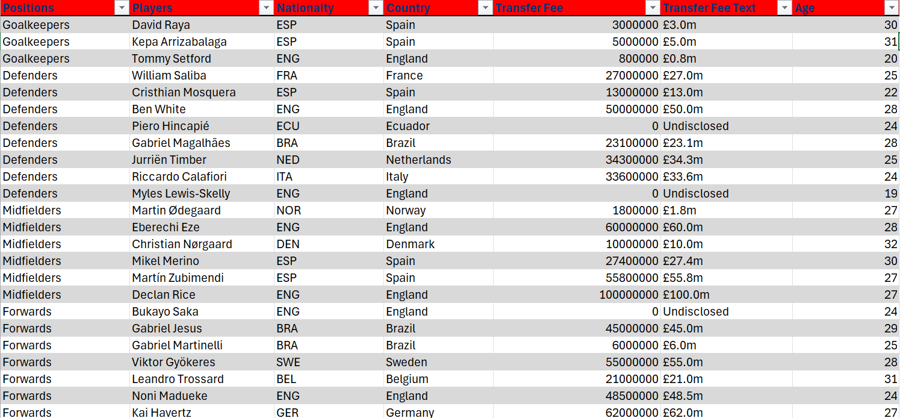
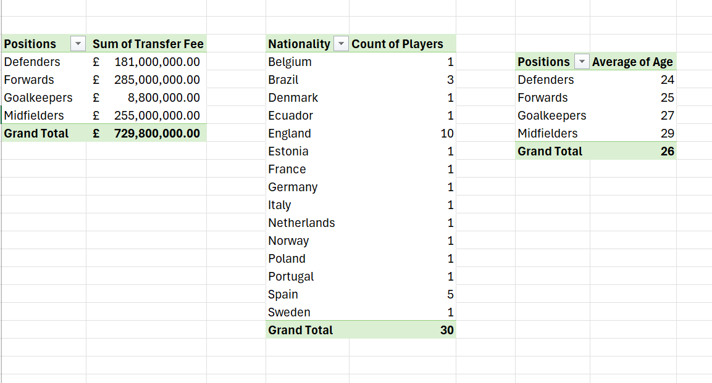
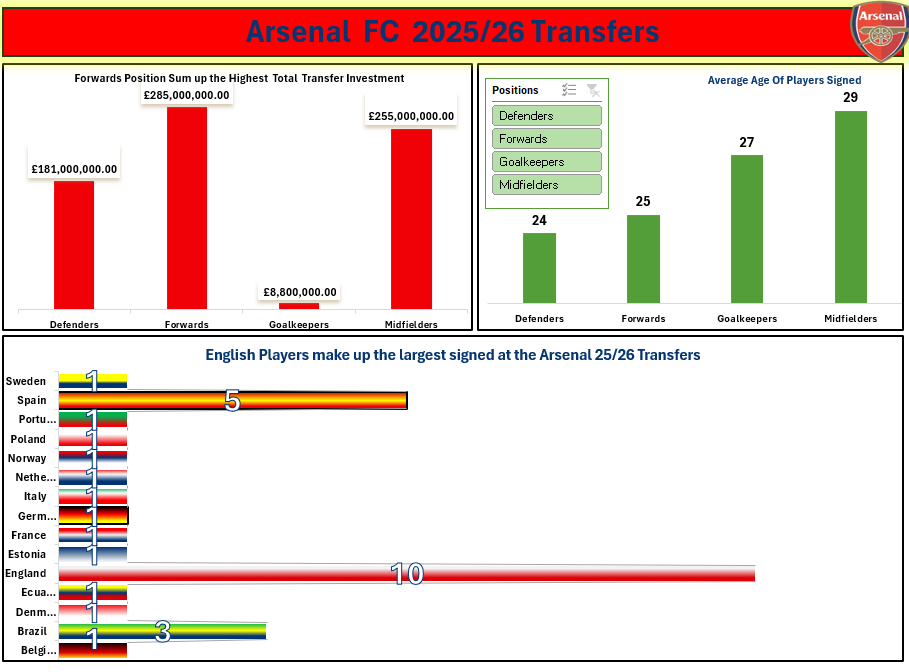

# Arsenal FC 2025/26 Transfers

## The Executive Summary
 This report is a concise analysis of Arsenal FC's 2025/26 transfer squad data 2025/26. It focuses on  transfer investment, player positions, age distribution, and nationality composition. 

## Business Context
Arsenal’s recruitment department wants to review the transfers that helped build the championship-winning squad.

## Objectives
This report addresses the following key questions:
- Which playing position received the highest total transfer investment?
- How many players did Arsenal sign from each country?
- What is the average age of players signed for each playing position?

## Data Overview
The dataset comprises 30 Arsenal players and includes key attributes such as position, age, nationality, and transfer fee.

## Data Preview 

## Key Findings
 - Arsenal invested approximately £729.8 million, with the highest expenditure allocated to forwards (£285 million) and midfielders (£255 million), highlighting a focus on strengthening attacking and creative positions.
- The team has an average age of 25.7 years, indicating a balanced mix of experienced players and emerging talent
English players form the largest proportion of the team, with 10 players, complemented by a diverse range of international talent from multiple countries.
- Defenders have the lowest average age (24.4 years), suggesting a strategic investment in younger players.
The overall team composition reflects a balanced recruitment approach that combines domestic talent, international diversity, youth development, and experienced players.
- The recruitment shows Major investments in several high-profile players.

## Dashboard 

## download Excel worksheet
click the link to access the live Report : 

## [please open the downloaded worksheet in Microsoft Excel to interact with the dashboard ](Arsenal_WK4.xlsx)

## Data Cleaning and Transformation
The dataset was sourced from the web and initially contained inconsistencies, unstructured information, this was resolved by formatting inconsistencies, organizing player information.

### Transfer Spending by Position
- Arsenal invested approximately £729.8 million across player acquisitions and team valuation.
- Midfielders received the highest investment at £255 million, closely followed by forwards at £285 million, indicating a strategic focus on strengthening attacking and creative areas of the squad.
- The highest proportion of spending was directed toward forwards (£285 million) and midfielders (£255 million)
###  Age Profile Analysis
 - The overall average teamage is approximately 25.7 years, indicating a balanced team made up of both experienced players and emerging talent. 
- Goalkeepers have the highest average age of 27 years, while defenders are the youngest group with an average age of 24.4 years, demonstrating Arsenal's commitment to building a long-term defensive foundation while maintaining experience in key positions.
### Nationality Distribution
- England represents the largest nationality group with 10 players, followed by Spain with 5 players.
- The team also includes players from 13 other countries, reflecting a diverse international recruitment strategy.
- The strong English representation supports compliance with homegrown player requirements while maintaining a blend of international talent.

 ### Notable Transfers
Among the most significant investments were:
- Declan Rice (£100 million)
- Kai Havertz (£62 million)
- Eberechi Eze (£60 million)
- Martín Zubimendi (£55.8 million)
- Viktor Gyökeres (£55 million) - These high-value signings demonstrate Arsenal's focus on acquiring proven players capable of making an immediate impact on team performance.

## Recommendations
- Continue balancing experienced signings with youth development to maintain long-term squad sustainability.
- Monitor the age profile of goalkeepers and midfielders to ensure succession planning for future seasons.
- Leverage the strong domestic player base while continuing to recruit high-quality international talent to improve squad depth and competitiveness.
- Evaluate the return on investment of high-value transfers through performance metrics and contribution analysis during the season.

 ## Tools Used
Microsoft Excel : For data cleaning, data transformation and visualization.

## Conclusion
Arsenal’s FC's 2025/26 recruitment strategy demonstrates a significant investment in strengthening attacking and midfield positions while maintaining a relatively young squad profile. The combination of experienced international talent and a strong domestic core positions the club well for both immediate success and long-term competitiveness. The transfer activity reflects a clear commitment to enhancing squad quality, increasing performance potential, and supporting sustained growth in future seasons.

